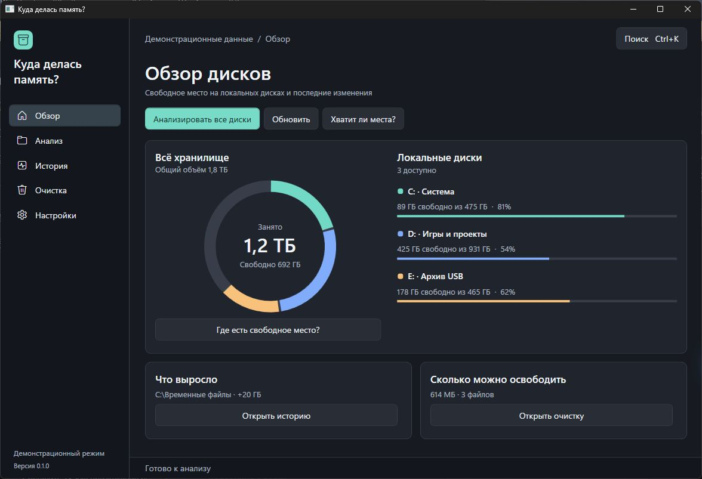

# Куда делась память?

Настольное приложение для Windows 11. Показывает, что заняло место на дисках, какие папки выросли и сколько можно освободить.

[Скачать последний релиз](../../releases/latest)



## Что умеет

- Сводка по локальным томам и USB. Нажмите сектор или карточку, чтобы открыть диск.
- Размеры на диске, карта папок, крупные файлы и поиск через **Ctrl+K**. Дубликаты ищутся по размеру и SHA-256.
- Сравнение локальных снимков и экспорт CSV. История показывает время замеров и интервал, в котором обнаружен прирост.
- Поиск просроченных файлов `.tmp` в корне пользовательской папки Temp, предварительный просмотр и удаление по подтверждению. Автоочистка требует отдельного включения и ограничивается возрастом, исключениями, простоем и лимитом за запуск.
- «Память Windows» открывает системные настройки. «Системная очистка» запускает штатный `cleanmgr.exe` с запросом UAC. Категории выбираются в диалоге Windows.
- Калькулятор свободного места, уведомления, трей, темы и демонстрационные данные.

## Запуск

Скачайте `KudaDelasPamyat-Setup-x64.exe` или распакуйте целиком `KudaDelasPamyat-windows-x64.zip` и запустите `DiskSpace.exe`. Отдельная установка .NET для этих пакетов не требуется. Для демонстрации используйте `DiskSpace.exe --demo`.

## Сборка

Требуются Windows x64 и SDK .NET 10. Для установщика нужен Inno Setup 6.

```powershell
dotnet run --project DiskSpace/DiskSpace.csproj
pwsh -File scripts/build.ps1
pwsh -File scripts/build.ps1 -Installer
```

Сборка проверяет выделенное место, учёт жёстких ссылок, хеширование, перечисление дисков, отмену и ограничения очистки.

## Данные и границы версии 0.1

Настройки, снимки и журнал хранятся локально в `%LOCALAPPDATA%\KudaDelasPamyat`. Для сравнения используются замеры и агрегаты первого уровня. При недоступных объектах результаты показывают число пропусков. История хранит до 400 снимков за 90 дней. Индекс файлов относится к текущей сессии. В целях экономии памяти детальный поиск ограничен 250 000 файлами на сканирование. Общий объём учитывается после достижения лимита.

В этой версии используется обход файловой системы без USN и локальные JSON-снимки. Системную очистку выполняет Windows. Публикуемые пакеты не подписаны Authenticode. Пользовательские снимки, файлы, пути и журналы не загружаются на GitHub.

[MIT](LICENSE).
